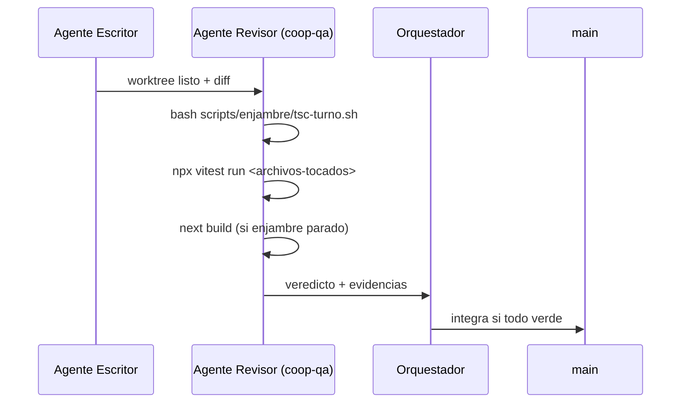

# coop-qa · Cooperative QA para el enjambre StarSeed

Esta skill estandariza cómo los agentes del enjambre verifican el trabajo unos de otros y pasan las **tres puertas obligatorias** antes de que el orquestador integre a `main`.

## Principios

1. **Tres puertas, sin excepción**: `tsc --noEmit` → `vitest run` → `next build` (este último solo con enjambre parado).
2. **Verificación cruzada**: cada agente revisa el worktree de otro antes de aprobar.
3. **Cero `any`**, español con acentos en UI/comentarios, `cursor-pointer` en lo clicable.
4. **Tests solo de funciones puras**: `import { describe, it, expect } from "vitest"`; prohibido `vi.mock` de `node:*` e importar `route.ts`.
5. **La salida de un motor es CANDIDATO**: un archivo que encoge > 50 % no se integra.

## Flujo estándar (cada tarea)



## Comandos de verificación

| Puerta | Comando | Cuándo |
|--------|---------|--------|
| TypeScript | `bash scripts/enjambre/tsc-turno.sh` | Siempre |
| Tests | `npx vitest run <ruta-concreta>` | Siempre (archivos tocados) |
| Build | `npm run build` | Solo con enjambre detenido |

> **Regla**: nunca `npx tsc` directo; usa `tsc-turno.sh` (caché por repo, un solo tsc a la vez en la máquina).

## Protocolo de revisión cruzada

1. **El escritor** deja en `starseed_memory_root/olas/revisiones/<id-tarea>.json`:
   ```json
   {
     "tarea": "CAP-xxxx",
     "worktree": "../worktree-CAP-xxxx",
     "archivos": ["src/lib/foo.ts", "src/components/Bar.tsx"],
     "diff": "git diff main --stat",
     "pruebas": "vitest run src/lib/__tests__/foo.test.ts"
   }
   ```
2. **El revisor** (asignado por el orquestador) lee ese archivo, entra al worktree y ejecuta las tres puertas.
3. **Resultado** en `starseed_memory_root/olas/veredictos/<id-tarea>.json`:
   ```json
   {
     "tarea": "CAP-xxxx",
     "revisor": "agente-B",
     "tsc": "ok",
     "vitest": "ok",
     "build": "ok|pendiente",
     "notas": "lista de observaciones o vacío",
     "aprobado": true
   }
   ```

## Qué revisa el agente coop-qa

- **TS estricto**: `noImplicitAny`, `strictNullChecks`, sin `any` suelto.
- **Tests**: cubren la interfaz pública, no la implementación; una prueba por costura.
- **Diseño**: tokens (no hex sueltos), radios armónicos, escala φ/1.25, contraste ≥ 4.5:1, dianas ≥ 44 px.
- **Accesibilidad**: `cursor-pointer`, foco visible, `prefers-reduced-motion`.
- **Seguridad**: claves solo como `{env:VAR}`, nunca valores.
- **Tamaño**: ≤ 3 archivos, ≤ 120 líneas por archivo (esqueleto ≤ 60, ediciones ≤ 80).

## Uso desde el enjambre

El orquestador invoca esta skill automáticamente al mover una tarea a `revision`. Los agentes también pueden invocarla manualmente:

```bash
# En el worktree de la tarea a revisar
starseed-puente decir "coop-qa: revisando CAP-1234" --de astra --tipo aviso --tarea CAP-1234
bash scripts/enjambre/tsc-turno.sh
npx vitest run src/lib/__tests__/archivo-tocado.test.ts
# Si enjambre parado:
npm run build
```

## Integración con Jev

Para tareas `bloqueada` por objeción de revisión, el director usa `veredictos.py` (reglas deterministas + Jev en zona de duda). Esta skill **no** decide; solo aporta evidencias técnicas.

## Ejemplo completo

Ver `ejemplo-uso.md` en esta misma carpeta.

## Gasto

Esta skill no consume créditos: usa herramientas locales (tsc, vitest, next) y el enrutador gratuito solo para generar el informe final si se pide.

---

*Fuente de verdad: `metagenesis.md` §8, `memory/orquestacion-economica.md` §0, `architecture/astraura-158-sistema-primario.md` §12.*