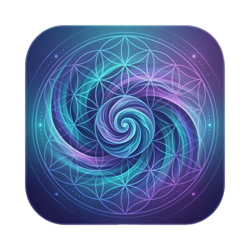
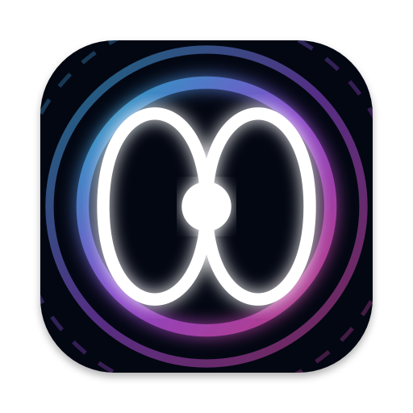
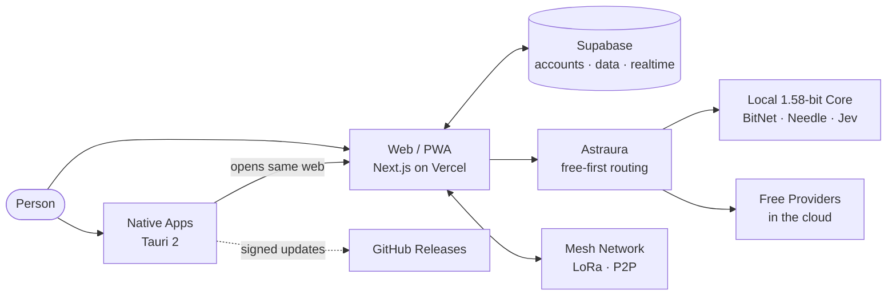

<div align="center">


# StarSeed OS

**The decentralized social operating system of the StarSeed Society: direct democracy, collective technology, and open source in a single network.**

[](https://github.com/StarSeedSystem/starseed-system/releases/latest)
[](LICENSE)
[](https://starseed-os.vercel.app)
[-f59e0b)](#downloads)

[**Open on the web**](https://starseed-os.vercel.app) · [**Downloads**](#downloads) · [**Documentation**](#documentation-and-links)

</div>

---

## What is StarSeed OS

StarSeed OS is a **shared digital space** where a community decides, learns, creates, and organizes without intermediaries. Each person has a private account and one or more public profiles; they can propose and vote, publish, open shared rooms, and count on **Astraura**, an artificial intelligence that works for you and prioritizes free and local resources.

It runs in the browser, installs as an app on mobile, and exists as a native desktop application. It is the digital part —the "mind"— of the [StarSeed Society](#documentation-and-links), and its code is a commons.

## Downloads

<!-- DESCARGAS:INICIO -->
Current version: **v0.2.0** (build `2026.09.24`, alpha channel). To avoid stale links, always use **[the latest release](https://github.com/StarSeedSystem/starseed-system/releases/latest)**. The [/install](https://starseed-os.vercel.app/install) page detects your device and recommends the appropriate file.

| System | File | Size | How to install |
|---|---|---|---|
| macOS (Apple Silicon & Intel) | [`StarSeed.OS_0.2.0_universal.dmg`](https://github.com/StarSeedSystem/starseed-system/releases/download/v0.2.0/StarSeed.OS_0.2.0_universal.dmg) | 6.7 MB | Open the `.dmg` and drag StarSeed OS to Applications. |
| Windows 10/11 | [`StarSeed.OS_0.2.0_x64-setup.exe`](https://github.com/StarSeedSystem/starseed-system/releases/download/v0.2.0/StarSeed.OS_0.2.0_x64-setup.exe) | 2.4 MB | Run the installer and follow the steps. |
| Windows (enterprise) | [`StarSeed.OS_0.2.0_x64_en-US.msi`](https://github.com/StarSeedSystem/starseed-system/releases/download/v0.2.0/StarSeed.OS_0.2.0_x64_en-US.msi) | 3.3 MB | MSI installer for managed deployments. |
| Linux (any distro) | [`StarSeed.OS_0.2.0_amd64.AppImage`](https://github.com/StarSeedSystem/starseed-system/releases/download/v0.2.0/StarSeed.OS_0.2.0_amd64.AppImage) | 78.2 MB | `chmod +x StarSeed.OS_0.2.0_amd64.AppImage` and run it. |
| Debian / Ubuntu | [`StarSeed.OS_0.2.0_amd64.deb`](https://github.com/StarSeedSystem/starseed-system/releases/download/v0.2.0/StarSeed.OS_0.2.0_amd64.deb) | 3.6 MB | `sudo apt install ./StarSeed.OS_0.2.0_amd64.deb` |
| Fedora / openSUSE | [`StarSeed.OS-0.2.0-1.x86_64.rpm`](https://github.com/StarSeedSystem/starseed-system/releases/download/v0.2.0/StarSeed.OS-0.2.0-1.x86_64.rpm) | 3.6 MB | `sudo dnf install ./StarSeed.OS-0.2.0-1.x86_64.rpm` |
| Android | [`StarSeed-os-0.2.0.apk`](https://github.com/StarSeedSystem/starseed-system/releases/download/v0.2.0/StarSeed-os-0.2.0.apk) | 27.4 MB | Open the APK and allow "install unknown apps" if prompted. |
| iPhone / iPad | Installable web app | — | In Safari: **Share → Add to Home Screen**. |
| Any browser | [starseed-os.vercel.app](https://starseed-os.vercel.app) | — | No installation needed. Can also be installed as PWA. |

**First launch.** macOS and Windows binaries are not yet signed by Apple or Microsoft, so the system will warn on first run:

- **macOS:** right-click the app → **Open** → **Open**.
- **Windows:** in SmartScreen, **More info → Run anyway**.

**Automatic updates.** Native apps (Tauri 2) check for a new version on startup and every 6 hours, and only install packages with verified signatures. The interface is served from the web, so content improvements arrive without reinstalling.

In the same release are the installers for **StarSeed Nexus** and **StarSeed Café** (same formats, with their name in the filename).
<!-- DESCARGAS:FIN -->

## Main Features

**Community & Governance**
- **Direct governance** (`/network/politics`, `/decisions`): proposals, voting, restorative mediation, and common resource management.
- **Education & culture** (`/network/education`, `/network/culture`): learning, publications, and artistic expression.
- **Private account & public profiles**: a single account with multiple facets (civic, artistic, professional).
- **Hub, messages, channels & feed** to organize communities.

**Artificial Intelligence: Astraura**
- **Free-first routing**: automatically chooses the most economical available provider and switches sources if one runs out.
- **Local 1.58-bit core**: BitNet generates, Needle decides which tool to use, and Jev gives verdicts with probability. If it runs on your device, your queries never leave it.
- Agents, personalities, brains, and memories configurable by account, profile, and device.

**Your System, Your Way**
- **Genesis** (`/genesis`): the multi-agent orchestration console —waves, tasks, agents, provider fleet, and handoff— with which StarSeed OS is programmed.
- **Library**: install apps and resources on the web or on any of your **neurons** (devices linked to your account), and assign them to the profile you want.
- **Desktops, whiteboards, 3D rooms & XR** synchronizable for group work.
- **AI-editable interface**, with an untouchable core: what is shared is reviewed before installation and foreign code never executes.

**Connectivity**
- **Real-time synchronization** between devices (Supabase Realtime) and P2P file sync with Syncthing.
- **Mesh network** LoRa/Meshtastic and P2P to communicate even without internet.
- **Voice**: synthesis and recognition, with local engines when the device allows.

**For Project Developers**
- **Project Genesis** (`/genesis`): the console from which StarSeed OS is programmed, with task waves, agents, and live providers. Only works on the project machine; in public deployment its APIs return 404. More in [`PUENTE-DE-MANDO.md`](PUENTE-DE-MANDO.md).

## StarSeed Ecosystem

| | App | What it does | Open | Code |
|---|---|---|---|---|
|  | **Audiomorphic** | Converts sound into living sacred geometry, with VR and AR. | [audiomorphic.vercel.app](https://audiomorphic.vercel.app) | [Audiomorphic-AR-app](https://github.com/StarSeedSystem/Audiomorphic-AR-app) |
|  | **Omnifrecuencias** | Frequency generator with 3D cymatics and live sessions. | [omnifrecuencias.vercel.app](https://omnifrecuencias.vercel.app) | [generador_frecuencias](https://github.com/StarSeedSystem/generador_frecuencias) |
|  | **StarSeed Nexus** | Brand and ecosystem portal. | [starseed-nexus.vercel.app](https://starseed-nexus.vercel.app) | — |
|  | **StarSeed Café** | Community meeting space. | [starseed-cafe.vercel.app](https://starseed-cafe.vercel.app) | — |
| | **Astraura 1.58** | Sovereign AI backend (BitNet b1.58). | [astraura.vercel.app](https://astraura.vercel.app) | [astraura](https://github.com/StarSeedSystem/astraura) |

Audiomorphic and Omnifrecuencias also work **inside** StarSeed OS (`/audiomorphic` and `/omnifrecuencias`), with their latest official version; Audiomorphic can even be used as animated desktop background.

## How It Works



- **Single interface.** The web (Next.js 15 + React 19) is the same in the browser and inside native apps. The native app ([`native/`](native/README.md)) adds what a browser cannot: notifications, auto-start, file and terminal access with your permission, and `starseed://` links.
- **Data.** Supabase manages authentication, database (Postgres with row-level policies), and realtime.
- **Neurons.** Each device linked to your account is a "neuron": can host apps, AI models, and files, and sync with the others.

**Stack:** Next.js 15 · React 19 · TypeScript · Tailwind CSS · shadcn/ui + Radix · Three.js / React Three Fiber · Framer Motion · Supabase · Genkit · Tauri 2 (Rust) · Vitest.

## Local Development

You need **Node.js 22** and npm.

```bash
git clone https://github.com/StarSeedSystem/starseed-system.git
cd starseed-system
npm install
cp .env.example .env.local   # fill in only what you need (Supabase at minimum)
npm run dev                  # http://localhost:9002
```

Before proposing a change, pass the three checks that CI also runs:

```bash
npm run typecheck   # TypeScript (tsc --noEmit)
npm test            # tests with Vitest
npm run build       # production build (generates version first)
```

Keys go only in `.env.local` (ignored by git). `.env.example` lists variable names, never values.

**Native apps.** Require Rust ≥ 1.77.2 and Tauri CLI 2. From `native/`: `cargo tauri build` (StarSeed OS), `cargo tauri build -c tauri.nexus.conf.json` or `-c tauri.cafe.conf.json`. Full guide in [`native/README.md`](native/README.md).

## Project Structure

```
.
├── src/
│   ├── app/            routes (App Router): (app)/, (main)/, api/, install/…
│   ├── components/     UI: mando/, library/, trinity/…
│   ├── ai/             Astraura: routing, providers & mesh
│   └── lib/            pure logic: version, library, sync, core…
├── native/             Tauri 2 native apps (OS, Nexus, Café)
├── supabase/           SQL migrations
├── scripts/            utilities: version, Genesis, verification
├── enjambre/           orchestration of agents developing the project
├── architecture/       technical procedures & decisions
├── memory/             principles, roadmap, architecture & log
├── design-system/      Liquid Crystal / Trinity design system
├── docs/               documentation & addenda
└── public/             icons & static assets
```

`CLAUDE.md` and `AGENTS.md` are the working memory for AI-assisted development.

## Privacy & Security

- **Your data is yours.** The account is private; only what you publish on a profile is public. Data lives in Supabase, protected by row-level access policies.
- **No ads or third-party trackers.** The code includes no commercial analytics.
- **Local AI first.** With the 1.58-bit core on your device, queries resolve there. Cloud provider keys are only on the server, never in your browser or the repository.
- **Explicit permissions.** The native app asks permission before using the terminal, files, or notifications, and only accepts signed updates.
- **Untouchable core.** No edit or shared package can remove the exit to Settings, sovereign identity, visible permissions, or vote integrity.

Found a vulnerability? Don't open a public issue: use **Security → Report a vulnerability** in this repository (if it doesn't appear, open an issue asking for a private channel, without details).

## Principles

Every function must pass this filter ([detail](memory/principles.md)):

- Respect the Triad: **Ontocracy** (direct democracy), **Cyberdelia** (technology to expand consciousness, never to control), and **Communist Transhumanism** (abundance & commons).
- The person is sovereign over their data.
- No tracking, ads, or paywalls for democratic functions.
- 100% open code; restorative, not punitive, moderation.
- Aesthetics elevate the user; they don't trap.

## Contributing

1. Read [`CONTRIBUTING.md`](CONTRIBUTING.md) and [`memory/principles.md`](memory/principles.md).
2. Search for or open an [issue](https://github.com/StarSeedSystem/starseed-system/issues); large proposals are discussed before coding.
3. Create a branch, follow [Conventional Commits](https://www.conventionalcommits.org/en/) and pass `typecheck`, `test`, and `build`.
4. Open a pull request explaining **what** changes, **why**, and **how you verified it**.

If you add a page, register it also in the dock and the app catalog: an unregistered route is invisible (see `CLAUDE.md` §11).

## Roadmap

- **Seed Phase** (2026): web & PWA, three ecosystems at minimum viable, native apps in alpha; ~100 people.
- **Fruit Phase** (2027): federation between nodes & own infrastructure; ~1,000 people.
- **Harvest Phase** (2028+): own Linux distro & systemic gratuity; 10,000+ people.

Detail in [`memory/roadmap.md`](memory/roadmap.md).

## License

[AGPL-3.0-or-later](LICENSE). The code is a commons: if you modify it and offer it as a network service, you must also publish your version.

## Documentation & Links

- **Web:** [starseed-os.vercel.app](https://starseed-os.vercel.app) · **Releases:** [latest version](https://github.com/StarSeedSystem/starseed-system/releases/latest)
- **Technical:** [`architecture/`](architecture/) · [`native/README.md`](native/README.md) · [`DESPLIEGUE.md`](DESPLIEGUE.md) · [`DESIGN.md`](DESIGN.md)
- **Foundational documents** (maximum project authority): [Constitution](https://docs.google.com/document/d/1XpltI3gkYN1Ma2wBVrlisPagL_HfeoF1RsnFKG09w4I/edit) · [Founding Manifesto](https://docs.google.com/document/d/1YiX9QK_JJHbmRMRj8fXrJeNffsDQ8T2RhzMHTeyavA0/edit) · [StarSeed Codex](https://docs.google.com/document/d/1Q7ygZvMlrVD4I7nO36jC4t8ttFezw__2K_w54L6HXNc/edit) · [SOSD Master Document](https://docs.google.com/document/d/1DaX2bl8dIMSKR1yVtOHqh3iVtV_sLARMiSPFGkywa3M/edit)
- **StarSeed Foundation:** [linktr.ee/FundacionStarseed](https://linktr.ee/FundacionStarseed)
- **Proposals about the product itself:** inside the network, at `/network/politics`.

---

<div align="center">

*"Here, technology serves the spirit. Here, power serves the truth. Here, life serves life."*
<br/>— Founding Manifesto of the StarSeed Society

</div>