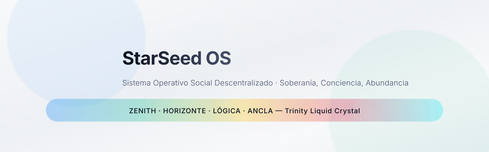
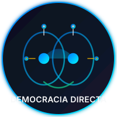
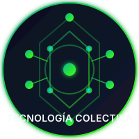
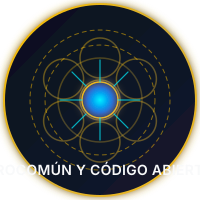
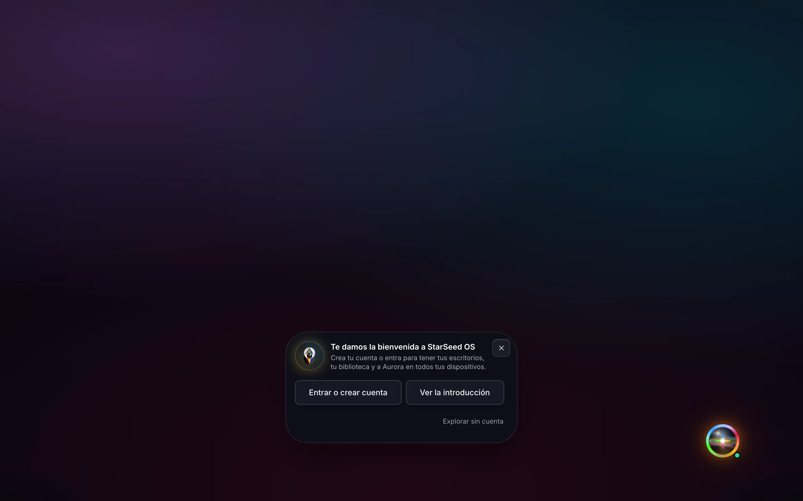
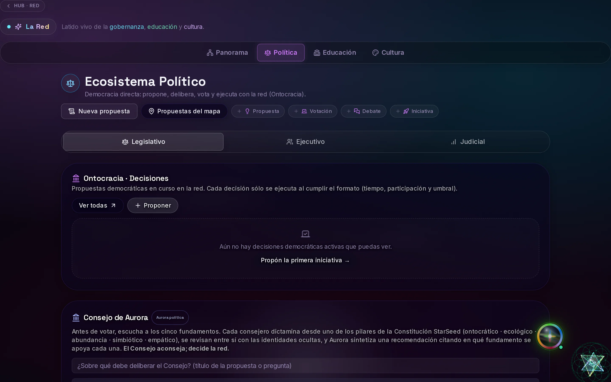
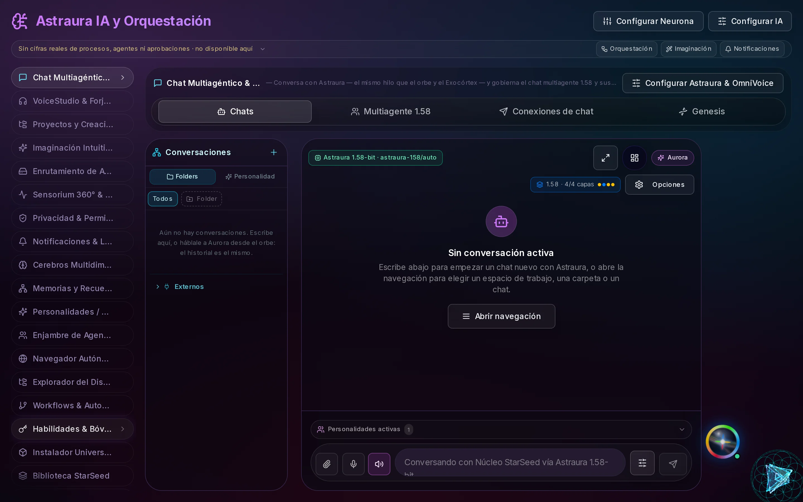
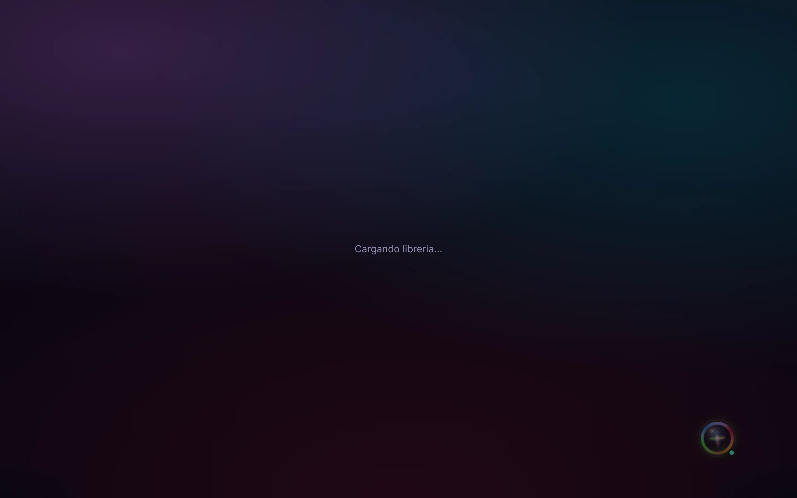
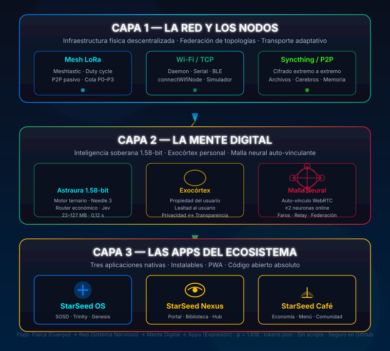

<div align="center">

<picture>
  <source media="(prefers-color-scheme: dark)" srcset="assets/readme/heroe-oscuro.svg">
  
</picture>

[](https://github.com/StarSeedSystem/starseed-system/releases/latest)
[](https://github.com/StarSeedSystem/starseed-system/releases/tag/canal-pruebas)
[](LICENSE)
[](https://starseed-os.vercel.app)
[-DC143C)](#downloads)

[**Open on the web**](https://starseed-os.vercel.app) · [**Download**](#downloads) · [**See how it works**](#how-it-works)

</div>

---

> **En español:** StarSeed OS es un sistema operativo social descentralizado de código abierto: gobernanza por democracia directa, educación, cultura, asistentes de IA y espacios compartidos, todo en un solo lugar. Funciona en cualquier navegador en [starseed-os.vercel.app](https://starseed-os.vercel.app) y como apps nativas auto-actualizables para macOS, Windows, Linux y Android ([última release](https://github.com/StarSeedSystem/starseed-system/releases/latest)). Construido con Next.js 15, React 19, Supabase y Tauri 2. Licencia AGPL-3.0. [**README completo en español**](README.md).

---

## In one sentence

**StarSeed OS is a shared digital space where a community decides, learns, creates, and organizes without intermediaries.**

## Three pillars

| | | |
|---|---|---|
|  |  |  |
| **Direct Democracy**<br/>Proposals, voting, restorative mediation, liquid delegated vote. One person, one voice. | **Collective Technology**<br/>LoRa/Meshtastic mesh, P2P, self-linking neural mesh. Sovereign infrastructure. | **Commons & Open Source**<br/>AGPL-3.0. Astraura 1.58-bit local. Code belongs to who uses it. |

---

## Real OS screenshots

| | | |
|---|---|---|
|  |  |  |
| **Landing** — Main accesses | **Governance** — Direct democracy | **Astraura** — Sovereign 1.58-bit AI |
| |  | |
| | **Library** — Resources & installables | |

> Screenshots taken at https://starseed-os.vercel.app (dark theme). Also available in light theme.

---

## Downloads

<!-- DESCARGAS:INICIO -->
| System | Stable | Test |
|---|---|---|
| macOS | [`StarSeed.OS_0.5.0_universal.dmg`](https://github.com/StarSeedSystem/starseed-system/releases/download/v0.5.0/StarSeed.OS_0.5.0_universal.dmg) · 6,7 MB · — | [`🧪 prueba.41`](https://github.com/StarSeedSystem/starseed-system/releases/download/canal-pruebas/StarSeed.OS_0.5.1-prueba.41_universal.dmg) · 6,8 MB · — |
| Windows (installer / MSI) | [`StarSeed.OS_0.5.0_x64-setup.exe`](https://github.com/StarSeedSystem/starseed-system/releases/download/v0.5.0/StarSeed.OS_0.5.0_x64-setup.exe) · 2,4 MB · — | [`🧪 prueba.41`](https://github.com/StarSeedSystem/starseed-system/releases/download/canal-pruebas/StarSeed.OS_0.5.1-prueba.41_x64-setup.exe) · 2,5 MB · — |
| Linux (AppImage / deb / rpm) | [`StarSeed.OS_0.5.0_amd64.AppImage`](https://github.com/StarSeedSystem/starseed-system/releases/download/v0.5.0/StarSeed.OS_0.5.0_amd64.AppImage) · 78,2 MB · — | [`🧪 prueba.41`](https://github.com/StarSeedSystem/starseed-system/releases/download/canal-pruebas/StarSeed.OS_0.5.1-prueba.41_amd64.AppImage) · 79,1 MB · — |
| Android | [`StarSeed-os-0.5.0.apk`](https://github.com/StarSeedSystem/starseed-system/releases/download/v0.5.0/StarSeed-os-0.5.0.apk) · 27,4 MB · — | [`🧪 prueba.41`](https://github.com/StarSeedSystem/starseed-system/releases/download/canal-pruebas/StarSeed-os-0.5.1-prueba.41.apk) · 27,8 MB · — |
| iOS (PWA) | Installable web app | — |
| Web | [starseed-os.vercel.app](https://starseed-os.vercel.app) | — |

> 🧪 **Test version · in development**: may fail; for daily use, choose stable.

<details>
<summary><strong>Other ecosystem apps</strong></summary>


**StarSeed Nexus**: [`StarSeed.Nexus_0.5.0_universal.dmg`](https://github.com/StarSeedSystem/starseed-system/releases/download/v0.5.0/StarSeed.Nexus_0.5.0_universal.dmg) · 6,5 MB · — · [`StarSeed.Nexus_0.5.0_x64-setup.exe`](https://github.com/StarSeedSystem/starseed-system/releases/download/v0.5.0/StarSeed.Nexus_0.5.0_x64-setup.exe) · 2,3 MB · —
**StarSeed Café**: [`StarSeed.Cafe_0.5.0_universal.dmg`](https://github.com/StarSeedSystem/starseed-system/releases/download/v0.5.0/StarSeed.Cafe_0.5.0_universal.dmg) · 5,7 MB · — · [`StarSeed.Cafe_0.5.0_x64-setup.exe`](https://github.com/StarSeedSystem/starseed-system/releases/download/v0.5.0/StarSeed.Cafe_0.5.0_x64-setup.exe) · 2,0 MB · —

</details>
<!-- DESCARGAS:FIN -->

---

## What's included

| Area | Status | Description |
|---|---|---|
| **Governance** (`/network/politics`, `/decisions`) | Stable | Proposals, voting, restorative mediation, common resource management |
| **Education** (`/network/education`) | Stable | Immersive learning, universal library, hybrid mentorship |
| **Culture** (`/network/culture`) | Stable | Artistic expression, Multiverse, coordinated events |
| **Sovereign account / Public profiles** | Stable | One private account, multiple public facets (civic, artistic, professional) |
| **Hub, messages, channels, feed** | Stable | Community organization |
| **Astraura 1.58-bit** (AI) | Stable | Free-first routing, local core (BitNet · Needle 3 · Jev), agents, personalities, brains, memories |
| **Genesis** (`/genesis`) | Stable | Multi-agent orchestration console (project machine only) |
| **Installable Library** | Stable | Apps & resources on web and neurons (linked devices) |
| **Desktops, whiteboards, 3D rooms, XR** | Beta | Synchronizable for group work |
| **AI-editable interface** | Beta | Untouchable core, review before install, no foreign code |
| **Real-time sync** (Supabase Realtime) | Stable | Accounts, data, live presence |
| **P2P file sync** (Syncthing) | Stable | End-to-end encrypted between devices |
| **LoRa / Meshtastic mesh** | Beta | Passive P2P discovery, smart router, duty cycle |
| **Neural mesh** (auto-link WebRTC) | Beta | ≥2 neurons online, beacons, relay, topology federation |
| **Voice** (synthesis/recognition) | Beta | Local engines when device allows |
| **Native apps** (Tauri 2) | Alpha | macOS, Windows, Linux, Android — signed updates, notifications, terminal, `starseed://` |
| **iOS** | In development | Installable PWA from Safari (no signed binary) |

> **Statuses:** *Stable* = ready for daily use · *Beta* = functional, may have rough edges · *Alpha* = early, for testing · *In development* = not yet available

---

## How it works



**Three layers, one flow:** Physical (Body) → Network (Nervous System) → Digital Mind → Apps (Expression)

1. **Layer 1 — The Network & Nodes**  
   Decentralized physical infrastructure: LoRa Mesh (Meshtastic, P0–P3 queue, duty cycle), Wi-Fi/TCP (daemon, serial, BLE, simulator), Syncthing/P2P (end-to-end encryption, files, brains, memory).

2. **Layer 2 — The Digital Mind**  
   Sovereign 1.58-bit intelligence: Astraura (ternary engine, Needle 3, economic router, Jev, 22–127 MB, 0.12 s), Exocortex (user-owned, user-loyal, privacy ↔ transparency), Neural Mesh (WebRTC auto-link ≥2 neurons, beacons, relay, federation).

3. **Layer 3 — The Ecosystem Apps**  
   StarSeed OS (SOSD, Trinity, Genesis), StarSeed Nexus (Portal, Library, Hub), StarSeed Café (Economy, Menu, Community). Three native apps, installable, PWA, fully open source.

---

## Get started in 1 minute

### Web (no install)
[Open https://starseed-os.vercel.app](https://starseed-os.vercel.app) → Works in any browser. Installable as PWA.

### Install native app
[Go to /install](https://starseed-os.vercel.app/install) → Detects your device and gives you the right file.  
Or download direct from [latest release](https://github.com/StarSeedSystem/starseed-system/releases/latest).

**First launch (macOS/Windows):** binaries not signed yet.
- macOS: right-click → **Open** → **Open**
- Windows: SmartScreen → **More info** → **Run anyway**

### Local development
```bash
git clone https://github.com/StarSeedSystem/starseed-system.git
cd starseed-system
npm install
cp .env.example .env.local   # fill only what you need (Supabase minimum)
npm run dev                  # http://localhost:9002
```

**Checks before proposing changes:**
```bash
npm run typecheck   # TypeScript (tsc --noEmit)
npm test            # tests with Vitest
npm run build       # production build
```

**Native apps (requires Rust ≥ 1.77.2 and Tauri CLI 2):**
```bash
cd native
cargo tauri build                         # StarSeed OS
cargo tauri build -c tauri.nexus.conf.json   # StarSeed Nexus
cargo tauri build -c tauri.cafe.conf.json    # StarSeed Café
```
Full guide in [`native/README.md`](native/README.md).

---

## StarSeed Ecosystem

| App | What it does | Open | Code |
|---|---|---|---|
| **Audiomorphic** | Sound → living sacred geometry, VR/AR | [audiomorphic.vercel.app](https://audiomorphic.vercel.app) | [Audiomorphic-AR-app](https://github.com/StarSeedSystem/Audiomorphic-AR-app) |
| **Omnifrecuencias** | Frequency generator, 3D cymatics, live sessions | [omnifrecuencias.vercel.app](https://omnifrecuencias.vercel.app) | [generador_frecuencias](https://github.com/StarSeedSystem/generador_frecuencias) |
| **StarSeed Nexus** | Brand & ecosystem portal | [starseed-nexus.vercel.app](https://starseed-nexus.vercel.app) | — |
| **StarSeed Café** | Community meeting space | [starseed-cafe.vercel.app](https://starseed-cafe.vercel.app) | — |
| **Astraura 1.58** | Sovereign AI backend (BitNet b1.58) | [astraura.vercel.app](https://astraura.vercel.app) | [astraura](https://github.com/StarSeedSystem/astraura) |

Audiomorphic and Omnifrecuencias also work **inside** StarSeed OS (`/audiomorphic` and `/omnifrecuencias`).

---

## Principles

Every function passes this filter ([detail](memory/principles.md)):

- **Ontocracy** — Direct democracy, individual sovereignty, liquid delegated vote, one person one voice.
- **Cyberdelia** — Technology to expand consciousness, never to control. Cyberdelic + liquid crystal aesthetic.
- **Communist Transhumanism** — Abundance, commons, automation that liberates. 100% open code.
- The person is sovereign over their data. No tracking, ads, or paywalls for democratic functions.
- Restorative, not punitive, moderation. Aesthetics elevate, they don't trap.

---

## Privacy & Security

- **Your data is yours.** Private account; only what you publish on a profile is public. Supabase with row-level access policies (RLS).
- **No ads or third-party trackers.** No commercial analytics.
- **Local AI first.** With the 1.58-bit core on your device, queries resolve there. Provider keys only on server.
- **Explicit permissions.** Native app asks before using terminal, files, notifications. Only signed updates.
- **Untouchable core.** No shared package can remove Settings exit, sovereign identity, visible permissions, or vote integrity.

Found a vulnerability? Don't open public issue: **Security → Report a vulnerability** in this repo (or ask for private channel without details).

---

## Roadmap

| Phase | Period | Goal | Status |
|---|---|---|---|
| **Seed** 🌱 | 2026 | Web/PWA, three ecosystems MVP, native apps alpha, ~100 people | **In progress** |
| **Fruit** 🌿 | 2027 | Federation between nodes, own infrastructure, ~1,000 people | Planned |
| **Harvest** 🌾 | 2028+ | Own Linux distro, systemic gratuity, 10,000+ people | Planned |

Detail in [`memory/roadmap.md`](memory/roadmap.md).

---

## Contributing

1. Read [`CONTRIBUTING.md`](CONTRIBUTING.md) and [`memory/principles.md`](memory/principles.md).
2. Search for or open an [issue](https://github.com/StarSeedSystem/starseed-system/issues); large proposals discussed first.
3. Create branch, follow [Conventional Commits](https://www.conventionalcommits.org/en/), pass `typecheck`, `test`, `build`.
4. Open pull request explaining **what** changes, **why**, and **how you verified it**.

> If you add a page, register it in the dock and app catalog: an unregistered route is invisible (see `CLAUDE.md` §11).

---

## License

[AGPL-3.0-or-later](LICENSE). The code is a commons: if you modify it and offer it as a network service, you must also publish your version.

---

## Documentation & Links

- **Web:** [starseed-os.vercel.app](https://starseed-os.vercel.app) · **Releases:** [latest version](https://github.com/StarSeedSystem/starseed-system/releases/latest)
- **Technical:** [`architecture/`](architecture/) · [`native/README.md`](native/README.md) · [`DESPLIEGUE.md`](DESPLIEGUE.md) · [`DESIGN.md`](DESIGN.md)
- **Foundational documents** (maximum authority): [Constitution](https://docs.google.com/document/d/1XpltI3gkYN1Ma2wBVrlisPagL_HfeoF1RsnFKG09w4I/edit) · [Founding Manifesto](https://docs.google.com/document/d/1YiX9QK_JJHbmRMRj8fXrJeNffsDQ8T2RhzMHTeyavA0/edit) · [StarSeed Codex](https://docs.google.com/document/d/1Q7ygZvMlrVD4I7nO36jC4t8ttFezw__2K_w54L6HXNc/edit) · [SOSD Master Document](https://docs.google.com/document/d/1DaX2bl8dIMSKR1yVtOHqh3iVtV_sLARMiSPFGkywa3M/edit)
- **StarSeed Foundation:** [linktr.ee/FundacionStarseed](https://linktr.ee/FundacionStarseed)
- **Proposals about the product:** inside the network, at `/network/politics`

---

<div align="center">

*"Here, technology serves the spirit. Here, power serves the truth. Here, life serves life."*  
<br/>— Founding Manifesto of the StarSeed Society

</div>