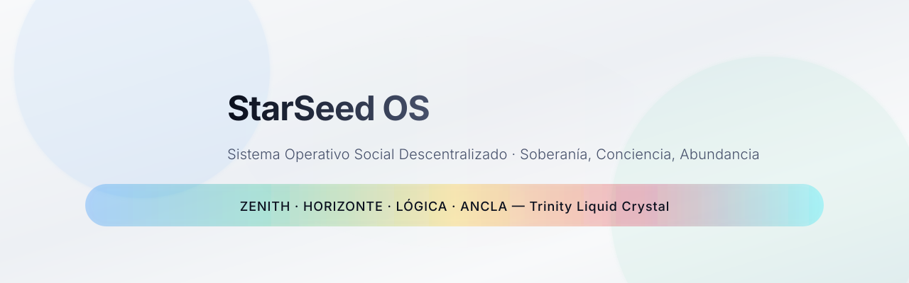
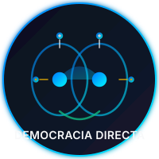
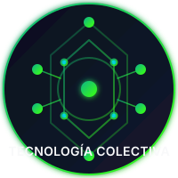
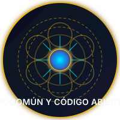
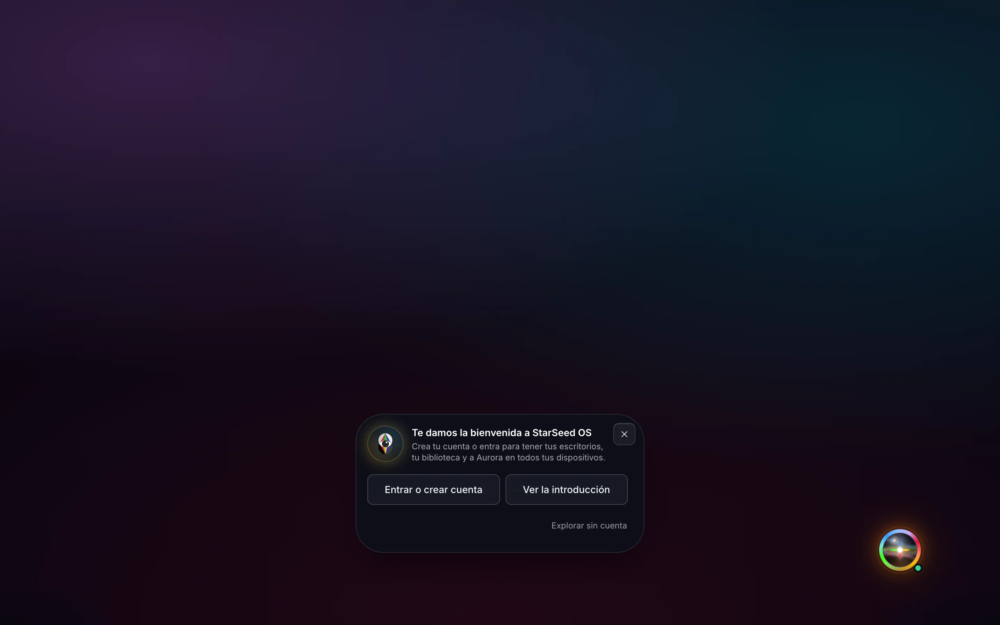
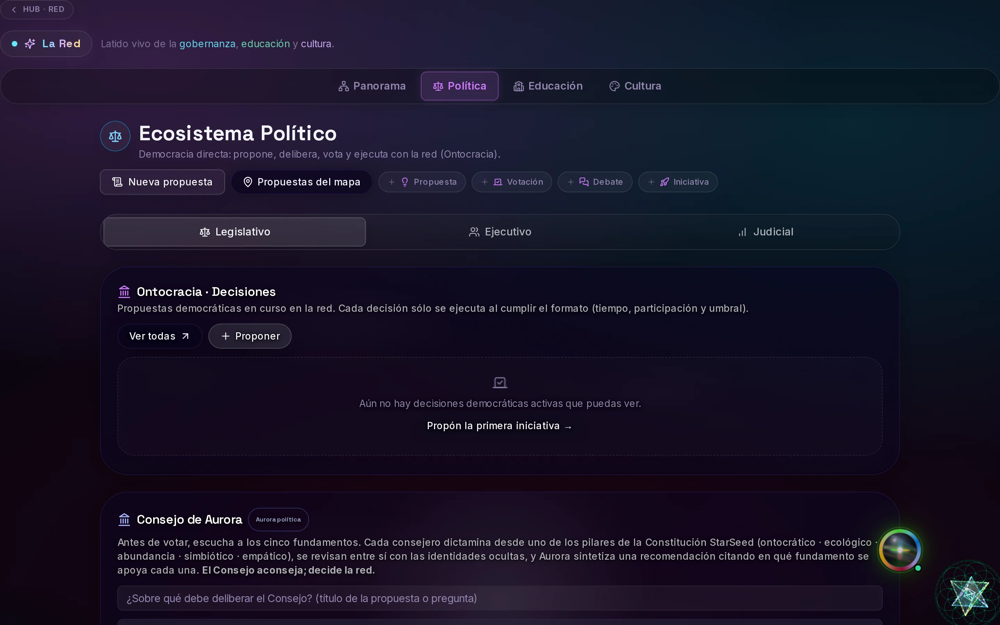
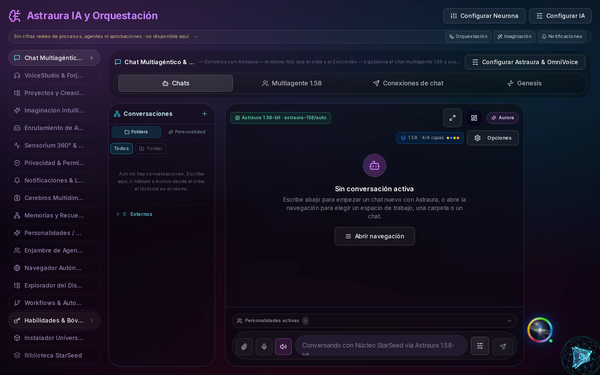
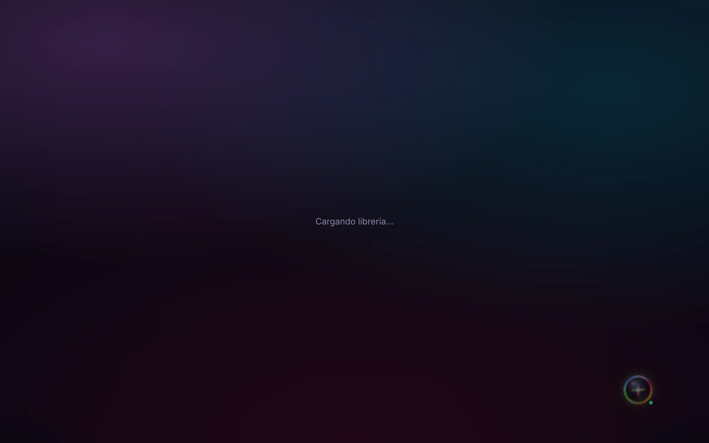
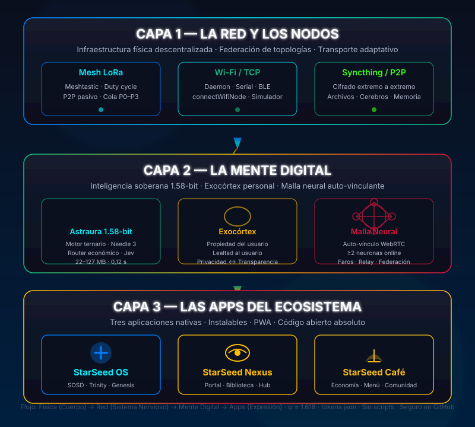

<div align="center">

<picture>
  <source media="(prefers-color-scheme: dark)" srcset="assets/readme/heroe-oscuro.svg">
  
</picture>

[](https://github.com/StarSeedSystem/starseed-system/releases/latest)
[](https://github.com/StarSeedSystem/starseed-system/releases/tag/canal-pruebas)
[](LICENSE)
[](https://starseed-os.vercel.app)
[-DC143C)](#descargas)

[**Abrir en la web**](https://starseed-os.vercel.app) · [**Descargar**](#descargas) · [**Ver cómo funciona**](#cómo-funciona)

</div>

---

> **In short (English):** StarSeed OS is an open-source, decentralized *social operating system*: governance by direct democracy, education, culture, AI assistants and shared spaces, all in one place. It runs in any browser at [starseed-os.vercel.app](https://starseed-os.vercel.app) and as self-updating native apps for macOS, Windows, Linux and Android ([latest release](https://github.com/StarSeedSystem/starseed-system/releases/latest)). Built with Next.js 15, React 19, Supabase and Tauri 2. Licensed under AGPL-3.0. [**Full English README**](README.en.md).

---

## En una frase

**StarSeed OS es un espacio digital común donde una comunidad decide, aprende, crea y se organiza sin intermediarios.**

## Tres pilares

| | | |
|---|---|---|
|  |  |  |
| **Democracia Directa**<br/>Propuestas, votación, mediación restaurativa y voto delegado líquido. Una persona, una voz. | **Tecnología Colectiva**<br/>Red mesh LoRa/Meshtastic, P2P, malla neural auto-vinculante. Infraestructura soberana. | **Procomún y Código Abierto**<br/>AGPL-3.0. Astraura 1.58-bit local. El código pertenece a quien lo usa. |

---

## Capturas reales del OS

| | | |
|---|---|---|
|  |  |  |
| **Portada** — Accesos principales | **Gobernanza** — Democracia directa | **Astraura** — IA soberana 1.58-bit |
| |  | |
| | **Biblioteca** — Recursos e instalables | |

> Capturas tomadas en https://starseed-os.vercel.app (tema noche). También disponible en tema nieve.

---

## Descargas

<!-- DESCARGAS:INICIO -->
| Sistema | Estable | Prueba |
|---|---|---|
| macOS | [`StarSeed.OS_0.5.0_universal.dmg`](https://github.com/StarSeedSystem/starseed-system/releases/download/v0.5.0/StarSeed.OS_0.5.0_universal.dmg) · 6,7 MB · — | [`🧪 prueba.41`](https://github.com/StarSeedSystem/starseed-system/releases/download/canal-pruebas/StarSeed.OS_0.5.1-prueba.41_universal.dmg) · 6,8 MB · — |
| Windows (instalador / MSI) | [`StarSeed.OS_0.5.0_x64-setup.exe`](https://github.com/StarSeedSystem/starseed-system/releases/download/v0.5.0/StarSeed.OS_0.5.0_x64-setup.exe) · 2,4 MB · — | [`🧪 prueba.41`](https://github.com/StarSeedSystem/starseed-system/releases/download/canal-pruebas/StarSeed.OS_0.5.1-prueba.41_x64-setup.exe) · 2,5 MB · — |
| Linux (AppImage / deb / rpm) | [`StarSeed.OS_0.5.0_amd64.AppImage`](https://github.com/StarSeedSystem/starseed-system/releases/download/v0.5.0/StarSeed.OS_0.5.0_amd64.AppImage) · 78,2 MB · — | [`🧪 prueba.41`](https://github.com/StarSeedSystem/starseed-system/releases/download/canal-pruebas/StarSeed.OS_0.5.1-prueba.41_amd64.AppImage) · 79,1 MB · — |
| Android | [`StarSeed-os-0.5.0.apk`](https://github.com/StarSeedSystem/starseed-system/releases/download/v0.5.0/StarSeed-os-0.5.0.apk) · 27,4 MB · — | [`🧪 prueba.41`](https://github.com/StarSeedSystem/starseed-system/releases/download/canal-pruebas/StarSeed-os-0.5.1-prueba.41.apk) · 27,8 MB · — |
| iOS (PWA) | App web instalable | — |
| Web | [starseed-os.vercel.app](https://starseed-os.vercel.app) | — |

> 🧪 **Versión de prueba · en desarrollo**: puede fallar; para uso diario, la estable.

<details>
<summary><strong>Otras apps del ecosistema</strong></summary>


**StarSeed Nexus**: [`StarSeed.Nexus_0.5.0_universal.dmg`](https://github.com/StarSeedSystem/starseed-system/releases/download/v0.5.0/StarSeed.Nexus_0.5.0_universal.dmg) · 6,5 MB · — · [`StarSeed.Nexus_0.5.0_x64-setup.exe`](https://github.com/StarSeedSystem/starseed-system/releases/download/v0.5.0/StarSeed.Nexus_0.5.0_x64-setup.exe) · 2,3 MB · —
**StarSeed Café**: [`StarSeed.Cafe_0.5.0_universal.dmg`](https://github.com/StarSeedSystem/starseed-system/releases/download/v0.5.0/StarSeed.Cafe_0.5.0_universal.dmg) · 5,7 MB · — · [`StarSeed.Cafe_0.5.0_x64-setup.exe`](https://github.com/StarSeedSystem/starseed-system/releases/download/v0.5.0/StarSeed.Cafe_0.5.0_x64-setup.exe) · 2,0 MB · —

</details>
<!-- DESCARGAS:FIN -->

---

## Qué incluye

| Área | Estado | Descripción |
|---|---|---|
| **Gobernanza** (`/network/politics`, `/decisiones`) | Estable | Propuestas, votación, mediación restaurativa, gestión de recursos comunes |
| **Educación** (`/network/education`) | Estable | Aprendizaje inmersivo, biblioteca universal, mentoría híbrida |
| **Cultura** (`/network/culture`) | Estable | Expresión artística, Multiverso, eventos coordinados |
| **Cuenta soberana / Perfiles públicos** | Estable | Una cuenta privada, múltiples facetas públicas (cívica, artística, profesional) |
| **Hub, mensajes, canales, feed** | Estable | Organización de comunidades |
| **Astraura 1.58-bit** (IA) | Estable | Enrutado gratis-primero, núcleo local (BitNet · Needle 3 · Jev), agentes, personalidades, cerebros, memorias |
| **Genesis** (`/genesis`) | Estable | Consola de orquestación multiagente (solo en máquina del proyecto) |
| **Biblioteca instalable** | Estable | Apps y recursos en web y neuronas (dispositivos vinculados) |
| **Escritorios, pizarras, salas 3D, XR** | Beta | Sincronizables para trabajo en grupo |
| **Interfaz editable por IA** | Beta | Núcleo intocable, revisión antes de instalar, sin código ajeno |
| **Sync tiempo real** (Supabase Realtime) | Estable | Cuentas, datos, presencia en vivo |
| **Sync archivos P2P** (Syncthing) | Estable | Cifrado extremo a extremo entre dispositivos |
| **Red mesh LoRa / Meshtastic** | Beta | Descubrimiento P2P pasivo, router inteligente, duty cycle |
| **Malla neural** (auto-vínculo WebRTC) | Beta | ≥2 neuronas online, faros, relay, federación de topologías |
| **Voz** (síntesis/ reconocimiento) | Beta | Motores locales cuando el dispositivo lo permite |
| **Apps nativas** (Tauri 2) | Alfa | macOS, Windows, Linux, Android — actualizaciones firmadas, notificaciones, terminal, `starseed://` |
| **iOS** | En desarrollo | PWA instalable desde Safari (sin binario firmado) |

> **Estados:** *Estable* = listo para uso diario · *Beta* = funcional, puede tener bordes ásperos · *Alfa* = temprano, para probar · *En desarrollo* = no disponible aún

---

## Cómo funciona



**Tres capas, un flujo:** Física (Cuerpo) → Red (Sistema Nervioso) → Mente Digital → Apps (Expresión)

1. **Capa 1 — La Red y los Nodos**  
   Infraestructura física descentralizada: Mesh LoRa (Meshtastic, cola P0–P3, duty cycle), Wi-Fi/TCP (daemon, serial, BLE, simulador), Syncthing/P2P (cifrado extremo a extremo, archivos, cerebros, memoria).

2. **Capa 2 — La Mente Digital**  
   Inteligencia soberana 1.58-bit: Astraura (motor ternario, Needle 3, router económico, Jev, 22–127 MB, 0,12 s), Exocórtex (propiedad del usuario, lealtad al usuario, privacidad ↔ transparencia), Malla Neural (auto-vínculo WebRTC ≥2 neuronas, faros, relay, federación).

3. **Capa 3 — Las Apps del Ecosistema**  
   StarSeed OS (SOSD, Trinity, Genesis), StarSeed Nexus (Portal, Biblioteca, Hub), StarSeed Café (Economía, Menú, Comunidad). Tres apps nativas, instalables, PWA, código abierto absoluto.

---

## Empezar en 1 minuto

### Web (sin instalar)
[Abrir https://starseed-os.vercel.app](https://starseed-os.vercel.app) → Funciona en cualquier navegador. Instalable como PWA.

### Instalar app nativa
[Ir a /instalar](https://starseed-os.vercel.app/instalar) → Detecta tu dispositivo y te da el archivo correcto.  
O descarga directo desde [la última release](https://github.com/StarSeedSystem/starseed-system/releases/latest).

**Primera apertura (macOS/Windows):** los binarios no están firmados aún.
- macOS: clic derecho → **Abrir** → **Abrir**
- Windows: SmartScreen → **Más información** → **Ejecutar de todas formas**

### Desarrollo local
```bash
git clone https://github.com/StarSeedSystem/starseed-system.git
cd starseed-system
npm install
cp .env.example .env.local   # rellena solo lo que necesites (Supabase mínimo)
npm run dev                  # http://localhost:9002
```

**Comprobaciones antes de proponer cambios:**
```bash
npm run typecheck   # TypeScript (tsc --noEmit)
npm test            # pruebas con Vitest
npm run build       # compilación de producción
```

**Apps nativas (requiere Rust ≥ 1.77.2 y Tauri CLI 2):**
```bash
cd native
cargo tauri build                    # StarSeed OS
cargo tauri build -c tauri.nexus.conf.json   # StarSeed Nexus
cargo tauri build -c tauri.cafe.conf.json    # StarSeed Café
```
Guía completa en [`native/README.md`](native/README.md).

---

## Ecosistema StarSeed

| App | Qué hace | Abrir | Código |
|---|---|---|---|
| **Audiomorphic** | Sonido → geometría sagrada viva, VR/AR | [audiomorphic.vercel.app](https://audiomorphic.vercel.app) | [Audiomorphic-AR-app](https://github.com/StarSeedSystem/Audiomorphic-AR-app) |
| **Omnifrecuencias** | Generador de frecuencias, cimática 3D, sesiones en vivo | [omnifrecuencias.vercel.app](https://omnifrecuencias.vercel.app) | [generador_frecuencias](https://github.com/StarSeedSystem/generador_frecuencias) |
| **StarSeed Nexus** | Portal de marca y ecosistema | [starseed-nexus.vercel.app](https://starseed-nexus.vercel.app) | — |
| **StarSeed Café** | Espacio de encuentro comunitario | [starseed-cafe.vercel.app](https://starseed-cafe.vercel.app) | — |
| **Astraura 1.58** | Backend soberano de IA (BitNet b1.58) | [astraura.vercel.app](https://astraura.vercel.app) | [astraura](https://github.com/StarSeedSystem/astraura) |

Audiomorphic y Omnifrecuencias también funcionan **dentro** de StarSeed OS (`/audiomorphic` y `/omnifrecuencias`).

---

## Principios

Toda función pasa este filtro ([detalle](memory/principles.md)):

- **Ontocracia** — Democracia directa, soberanía individual, voto delegado líquido, una persona una voz.
- **Ciberdelia** — Tecnología para expandir la conciencia, nunca para controlar. Estética cyberdélica + cristal líquido.
- **Transhumanismo Comunista** — Abundancia, procomún, automatización que libera. Código 100 % abierto.
- La persona es soberana sobre sus datos. Sin rastreo, publicidad ni pago para funciones democráticas.
- Moderación restaurativa, no punitiva. La estética eleva, no atrapa.

---

## Privacidad y seguridad

- **Tus datos son tuyos.** Cuenta privada; solo lo que publicas en un perfil es público. Supabase con políticas de acceso por fila (RLS).
- **Sin publicidad ni rastreadores de terceros.** Sin analítica comercial.
- **IA local primero.** Con el núcleo 1.58-bit en tu dispositivo, las consultas se resuelven allí. Claves de proveedores solo en servidor.
- **Permisos explícitos.** La app nativa pide permiso antes de usar terminal, archivos, notificaciones. Solo actualizaciones firmadas.
- **Núcleo intocable.** Ningún paquete compartido puede quitar la salida a Ajustes, la identidad soberana, los permisos visibles ni la integridad del voto.

¿Vulnerabilidad? No abras issue público: **Security → Report a vulnerability** en este repo (o pide canal privado sin detalles).

---

## Hoja de ruta

| Fase | Periodo | Objetivo | Estado |
|---|---|---|---|
| **Semilla** 🌱 | 2026 | Web/PWA, tres ecosistemas MVP, apps nativas alfa, ~100 personas | **En curso** |
| **Fruto** 🌿 | 2027 | Federación entre nodos, infraestructura propia, ~1.000 personas | Planificada |
| **Cosecha** 🌾 | 2028+ | Distribución Linux propia, gratuidad sistémica, 10.000+ personas | Planificada |

Detalle en [`memory/roadmap.md`](memory/roadmap.md).

---

## Contribuir

1. Lee [`CONTRIBUTING.md`](CONTRIBUTING.md) y [`memory/principles.md`](memory/principles.md).
2. Busca o abre un [issue](https://github.com/StarSeedSystem/starseed-system/issues); propuestas grandes se debaten antes.
3. Crea rama, sigue [Conventional Commits](https://www.conventionalcommits.org/es/), pasa `typecheck`, `test`, `build`.
4. Abre pull request explicando **qué** cambia, **por qué** y **cómo lo verificaste**.

> Si añades una página, regístrala en el dock y en el catálogo de apps: una ruta sin registrar no la ve nadie (ver `CLAUDE.md` §11).

---

## Licencia

[AGPL-3.0-or-later](LICENSE). El código es procomún: si lo modificas y lo ofreces como servicio en red, debes publicar tu versión.

---

## Documentación y enlaces

- **Web:** [starseed-os.vercel.app](https://starseed-os.vercel.app) · **Releases:** [última versión](https://github.com/StarSeedSystem/starseed-system/releases/latest)
- **Técnica:** [`architecture/`](architecture/) · [`native/README.md`](native/README.md) · [`DESPLIEGUE.md`](DESPLIEGUE.md) · [`DESIGN.md`](DESIGN.md)
- **Documentos fundacionales** (autoridad máxima): [Constitución](https://docs.google.com/document/d/1XpltI3gkYN1Ma2wBVrlisPagL_HfeoF1RsnFKG09w4I/edit) · [Manifiesto Fundacional](https://docs.google.com/document/d/1YiX9QK_JJHbmRMRj8fXrJeNffsDQ8T2RhzMHTeyavA0/edit) · [Codex StarSeed](https://docs.google.com/document/d/1Q7ygZvMlrVD4I7nO36jC4t8ttFezw__2K_w54L6HXNc/edit) · [Documento Maestro del SOSD](https://docs.google.com/document/d/1DaX2bl8dIMSKR1yVtOHqh3iVtV_sLARMiSPFGkywa3M/edit)
- **Fundación StarSeed:** [linktr.ee/FundacionStarseed](https://linktr.ee/FundacionStarseed)
- **Propuestas sobre el producto:** dentro de la red, en `/network/politics`

---

<div align="center">

*«Aquí, la tecnología sirve al espíritu. Aquí, el poder sirve a la verdad. Aquí, la vida sirve a la vida.»*  
<br/>— Manifiesto Fundacional de la Sociedad StarSeed

</div>